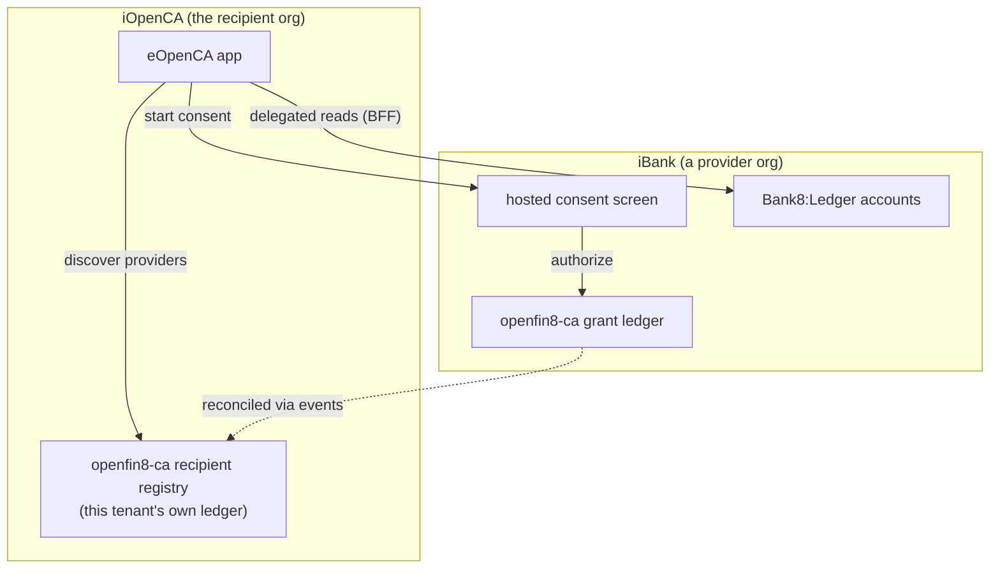

# eOpenCA - Open Finance Data Recipient App

eOpenCA (the former eFintech of bank8) is the recipient app of the
OpenFin8 vertical: the fintech side of the two-ledger model. A
recipient institution (e.g. "iOpenCA") runs its own environment; its
customers discover external providers, authorize consents at the
provider bank's hosted screen, and read back their consented account
and transaction data - every read attributable to a live grant,
enforced server-side.

## What the app covers

- **Provider catalog** - discovery of connectable providers
- **The consent journey** - start, authorize (hosted at the provider
  bank), callback, active connection
- **Consented data** - account list + detail, transactions
- **Consent review** - the dashboard of active grants + revocation
- **Admin** - instance overview + recipient-side administration (RFW
  pages in the platform dashboard)

## The recipient plane

The app consumes only the recipient surfaces
(`/v1/recipient/*`) through the platform BFF - no direct service
calls, no provider-side tables. The two-ledger design keeps the
fintech's registry and the bank's grant ledger in separate tenants,
reconciled through the `openfin8:ca:*` event family.

- [Architecture (DDD)](design)
- [Business rules (BRD)](business)
- [Security](security)
- [The repository](https://github.com/OpenFin8/openfin8-eopenca)