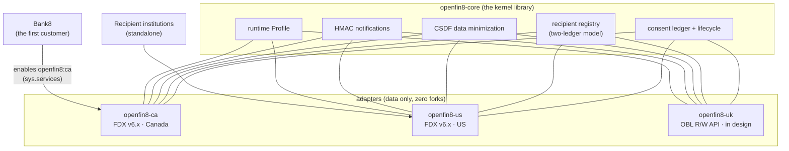

# OpenFin8 - the open-finance vertical

OpenFin8 is consent-first financial data sharing, composed on the
Sentin8 platform: one kernel library and thin per-jurisdiction
adapters that own the openfin8 database. Banking is its first sector
- [Bank8](https://bank8.dev/) composes the provider role - and
recipient-only fintechs compose the recipient plane standalone. It
contains **no platform infrastructure of its own**: identity,
events, storage, scheduling, workflows, and supervision are consumed
from the platform, so every adapter inherits the authorization
pipeline and audit posture.

## Where to read

| Path | What it covers |
|---|---|
| [Products](/docs/products/openfin8-ca/) | Each jurisdiction adapter - the served surface, the ceremony, the wire |
| API reference (sidebar "API") | The interactive, generated reference for every OpenFin8-owned route - `openfin8-ca`, `openfin8-us`, `openfin8-uk` |
| [SDK (the kernel)](/docs/sdk/) | openfin8-core - the library every adapter embeds |
| [Security](/docs/security/) | The consent boundary, minimization, the OBVERT boundary, spec licensing |
| [Developers](/docs/developers/) | Integrating as a recipient or a provider |
| [Samples](/docs/samples/) | Reference journeys: consent ceremony, webhooks, the two-ledger flow |
| [Reference](/docs/reference/) | The harvested per-repo docs (README, DESIGN, BUSINESS, SECURITY) |

## The markets

| Market | Standard | Status |
|---|---|---|
| Canada | FDX v6.x | serving |
| United States | FDX v6.x | serving |
| United Kingdom | OBL Read/Write API | in design (OBARCH-5) |
| Brazil | Open Finance Brasil | designed |
| European Union | Berlin Group openFinance | designed |
| Australia | CDR | designed |

A bank activates a market by enabling one service in an environment -
not by porting software.