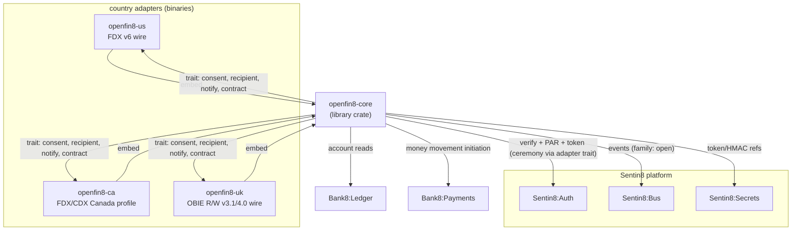
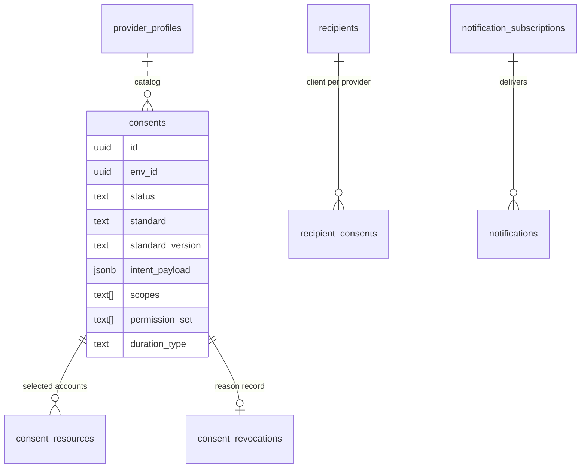

# openfin8-core - Detailed Design Document

> This crate is the shared foundation under `openfin8-us`,
> `openfin8-ca`, `openfin8-uk`, `openfin8-eu` (with
> `openfin8-br`/`openfin8-au` to land under the same contract).
> Reading order: this document, then the per-country adapter designs
> (`openfin8-us`, `openfin8-ca`, `openfin8-uk`, `openfin8-eu`).

## 1. Scope & Context

**What this crate is.** `openfin8-core` is the jurisdiction-agnostic
open-finance kernel: the consent ledger, the recipient registry, the
CSDF data-minimization engine, the notification delivery worker, the
admin/RFW page framework, the audit discipline, and the wire-agnostic
service traits that country adapters implement. It is a **library
crate, not a service binary** - no process runs on it; each
`openfin8-*` binary embeds it and supplies its wire surface, its
contract table, and its registration data.

**Where it lives.** In the `bank8-sdk` repository as
`crates/open/core` (`openfin8-core`), sibling to the existing
per-service contracts crates, re-exported through the `bank8` facade.
Rationale: (a) it is shared library code with no deployment identity
of its own - the same positioning rule as the SDK contracts crates
(RS §2.3); (b) it carries no secrets, TLS, or database runtime - the
embedding service owns boot; (c) adapters already depend on the SDK
git pin, so the version pin rides the existing `bank8-v*` tags with
no new supply chain.

**What moves here from `bank8-fdx` (the extraction inventory).**
~70% of the current service is standard-agnostic and moves as-is:

| Current module (bank8-fdx) | Disposition in core | Notes |
|---|---|---|
| `consent_records.rs`, `common.rs` (grant-ledger halves) | `core::consent` | grant ledger, revocation records, lifecycle windows - **standard-agnostic today** |
| `recipients`/`recipient_consents` plumbing in `handlers.rs` | `core::recipient` | two-ledger model, DCR cache pattern, token-reference custody |
| `csdf.rs` | `core::csdf` | cluster vocabulary + scope mapping table moves to adapter config (§4); filter engine stays |
| `event_notifications.rs` (worker) | `core::notify` | HMAC delivery worker - envelope shape parameterized by adapter |
| `admin_ui.rs` pages (overview/consents/recipients/settings) | `core::admin` | page constructors shared; jurisdiction-specific cards supplied by adapter |
| `audit_events` helpers | `core::audit` | `data_call*` discipline unchanged |
| `flow.rs` step profile | `core::flow` | proxy-back step contract unchanged |
| `policy.rs`, `errors.rs`, `headers.rs`, `tokens.rs` | `core::runtime` | Shield/verify/error plumbing shared |
| `validation.rs`, `middleware.rs` route/contract halves | `core::contract` **trait** | route table + FAPI headers become adapter-supplied data |
| `/fdx/v6/*` handlers (`handlers.rs` proxy halves, `money_movement.rs`, `pip.rs`, `recurring.rs`, `payment_networks.rs`, `statement_download.rs`, `tax.rs`, `operations.rs`) | **stay in adapters** | these are the FDX wire surface |
| `consent_rfw.rs` hosted consent screens | `core::rfw` with adapter screen params | scope wording + account picker are standard-flavored |
| SQL (15 domain tables) | **moves to core SQL**, parameterized schema name | §5 |

**The two-ledger model survives unchanged** (fdx DESIGN §1): the
provider's grant ledger and the recipient's consent registry are
in separate tenants, no cross-tenant SQL ever. What changes is only
which wire the ceremony speaks - FDX, OBIE, or CDX - and that is
adapter-owned.

**Core does NOT own**: the OAuth ceremony at Auth (each standard's
FAPI profile differs fundamentally - DPoP vs hybrid+JWS vs CIBA),
money-movement execution (Bank8:Payments owns it; core defines only
the initiation DTO seam), statement bytes (Sentin8:Storage), and any
standard-specific wire format.



## 2. The Service Traits (the adapter contract)

The crate's public surface is four traits plus config/data types.
Every country adapter implements them; core supplies the axum router,
the middleware chokepoints, the consumers, and the workers that call
through them.

```rust
/// The wire-flavor descriptor - what an adapter IS.
pub trait OpenBankingProfile: Send + Sync + 'static {
    /// e.g. "us", "ca", "uk" - key for config, admin pages, metrics.
    fn jurisdiction(&self) -> &'static str;
    /// The standard's own identity, e.g. "FDX 6.5", "OBIE 3.1.11".
    fn standard(&self) -> StandardDescriptor;
    /// Route prefix the provider surface mounts under,
    /// e.g. "/fdx/v6" or "/open-banking/v3.1.11".
    fn provider_prefix(&self) -> String;
    /// Version string announced on capability/discovery surfaces.
    fn announced_version(&self) -> String;
    /// Cluster vocabulary for this standard (CSDF input, §4).
    fn data_clusters(&self) -> &'static [DataClusterDef];
    /// Scope→cluster mapping the ceremony uses.
    fn scope_to_clusters(&self, scope: &str) -> Vec<DataCluster>;
    /// Route-contract table for request validation + 401/403/404/405
    /// semantics (core::contract consumes it; replaces the hardcoded
    /// `routes` array in today's validation.rs).
    fn route_contract(&self) -> &'static [RouteDef];
    /// Envelope codec for this standard's response wrapping
    /// (UK {Data, Links, Meta}; FDX flat JSON).
    fn envelope(&self) -> EnvelopeStyle;
    /// Spec publication policy - what docs/openapi.json may carry
    /// (US/CA must exclude the standard surface).
    fn spec_publication(&self) -> SpecPublicationPolicy;
}

/// The OAuth ceremony the adapter's AS integration speaks.
/// Implemented against sentin8::auth::client - Auth keeps its own
/// profile flags per jurisdiction (DPoP vs hybrid+JWS vs CIBA).
pub trait ConsentCeremony: Send + Sync + 'static {
    /// Register/lookup the recipient's OAuth client at the provider's
    /// AS (RFC 7591 DCR; UK adds software-statement assertions).
    async fn ensure_client(&self, ctx: &CeremonyCtx, recipient: &Recipient)
        -> Result<ClientRegistration, CeremonyError>;
    /// Build the authorization redirect (PAR where the profile has it;
    /// UK hybrid carries intent-id binding in the request object).
    async fn start_authorization(&self, ctx: &CeremonyCtx, grant: &ConsentGrant)
        -> Result<AuthorizationRedirect, CeremonyError>;
    /// Exchange code for tokens (PKCE always; + DPoP proof for US/CA,
    /// + detached JWS for UK request signing where mandated).
    async fn exchange_code(&self, ctx: &CeremonyCtx, code: &str,
        verifier: &str) -> Result<DelegatedTokens, CeremonyError>;
    /// Refresh path (sender-constrained per profile).
    async fn refresh(&self, ctx: &CeremonyCtx, consent: &RecipientConsent)
        -> Result<DelegatedTokens, CeremonyError>;
}

/// The wire handlers - the standard's resource surface. Core mounts
/// them behind the consent middleware; the adapter maps its resource
/// families to the shared data-plane calls.
pub trait ProviderWire: Send + Sync + 'static {
    /// The provider sub-router for this standard, mounted by core
    /// behind provider_middleware with the adapter's route contract.
    fn provider_router(&self, state: &CoreState) -> axum::Router<CoreState>;
}

/// Hosted consent screen parameters - the RFW page flavor.
pub trait ConsentScreens: Send + Sync + 'static {
    /// Scope display wording for the authorize screen.
    fn scope_labels(&self, scope: &str) -> String;
    /// Extra account-picker fields this standard shows.
    fn account_picker_extras(&self) -> Vec<rfw::FormField>;
}
```

`CoreState` is the shared AppState (config, pool, policy engine,
ceremony impl, profile impl, caches) - each adapter constructs it via
`core::state::build(profile, ceremony, config_from_env)` and hands it
to `core::server::routes()`, which composes: standard middleware →
provider sub-router (adapter) → shared `/v1/recipient/*` +
`/v1/auth/consent/*` + `/v1/admin/*` + `/v1/health` routers (core,
reusing today's shapes).

## 3. Data Model

The 15 domain tables move to a **schema parameterized by profile**
(`open_us`, `open_ca`, `open_uk` ...) rather than living in `fdx`:

- **Unchanged shapes**: `consents`, `consent_resources`,
  `consent_revocations`, `recipient_consents`, `recipients`,
  `provider_profiles`, `audit_events`, `notification_subscriptions`,
  `notifications`, `payment_initiation_parties`,
  `pip_payment_methods`, `payment_network_revocations`,
  `outbox`, `audit_journal`. The fdx SQL is the seed; core owns the
  migration SQL and the adapters request a schema via
  `core::sql::migrations(schema: &str)`.
- **Generalized columns**: `consents.status` widens its CHECK to the
  union of jurisdiction state machines: `pending | active |
  awaiting_authorization | expired | revoked |
  reauthorization_required` (UK's intent phase = `awaiting_authorization`
  between creation and PSU ceremony; XS2A's four-state maps onto the
  same set). `consents.standard` + `consents.standard_version`
  record the serving profile; `provider_profiles.fdx_version`
  generalizes to `standard_version` (data migration on the fdx →
  open_us rename).
- **New**: `consents.intent_payload JSONB` - the
  standard-specific intent document (UK intent-id binding, BR
  enrollment manifest, XS2A consent body) stored opaque to core,
  rendered by the adapter; `consent_resources` gains
  `permission_set TEXT[]` (UK permission arrays replace bare
  cluster names 1:1 - same column type, adapter-decoded).

The outbox/audit-journal producer tables follow the
schema-per-service rule unchanged (DBX §6.6): each adapter's schema
carries its own.



## 4. CSDF Generalization

The minimization engine (`core::csdf`) is unchanged in mechanics -
project a response to the granted clusters before serialization. The
**vocabulary becomes profile data**: today's fixed
`DataCluster::{Accounts,Payments,Statements,Customers,Transactions,Transfers,Tax}`
enum becomes `DataCluster(String)` validated against
`profile.data_clusters()`, and `scope_to_clusters` moves from the
hardcoded match in `csdf.rs` to the profile trait. UK's OB permission
arrays (`ReadAccountsBasic` etc.) and FDX's clusters are two
vocabularies over the same filter engine. The filter itself remains
pure-function tested per vocabulary.

## 5. Events, Notifications, Admin

- **Event family** renames from `fdx` to per-profile
  `open_us`/`open_ca`/`open_uk` (or stays `open` with jurisdiction
  payload field - decided: **per-profile families**, so consumer
  permissions stay scoped; `stream_family` env var per service
  matches today's `BANK8_FDX_STREAM_FAMILY` pattern). The type
  grammar `bank8:{family}:{resource}:{operation}` is unchanged.
- **Notification worker**: the HMAC-signing delivery worker moves
  wholesale; the payload envelope becomes
  `profile.envelope()`-rendered (UK adds JWS-signed event
  notification bodies - the worker gains a signing step behind the
  trait when the UK adapter lands; US/CA keep plain HMAC).
- **Admin RFW**: the four shared pages (overview/consents/recipients/
  settings) move to core; the settings page renders the profile's
  version selector from `profile.announced_version()` options rather
  than a hardcoded "6.5".

## 6. Version & Jurisdiction Configuration

Two layers, deliberately:

1. **Per-environment service enablement** - unchanged platform
   mechanism. Each adapter is its own `service_type`
   (`openfin8:us`, ...) in `catalog.json` + its own
   `service-registration.json`; `sys.services.config` JSONB carries
   per-env settings (default version, capability toggles) read at
   env-init through the existing `sentin8:sys:service:updated`
   consumer.
2. **Per-deployment version selection** - env vars
   (`BANK8_OPEN_US_VERSION=6.5`, `BANK8_OPEN_CA_VERSION=6.5`,
   `BANK8_OPEN_UK_VERSION=3.1.11`|`4.0.1`) parsed by each adapter's
   config into `standard.version`, feeding `provider_prefix()`,
   `announced_version()`, and the admin settings page. The route
   mounts derive the major segment from the configured version
   (replacing the 6 hardcoded `v6` strings). Config precedence:
   `sys.services.config` (per-env) → env var → profile default.

## 7. Spec Publication tie-in

`SpecPublicationPolicy` in the profile trait controls what the
embedding service may publish in `docs/openapi.json`:

| Profile | Policy | Effect |
|---|---|---|
| US, CA | `CustomerSupplied` | published spec carries ONLY bank8-owned routes (`/v1/*`); the standard surface is never committed; customer drops the licensed FDX yaml under gitignored `specs/` |
| UK | `Vendored` | OB specs are MIT-licensed - the UK adapter MAY carry its swagger-derived paths with the OBL notice |

The drift-guard test (per adapter) asserts the published spec matches
the policy - no `/fdx/` or `/open-banking/` paths in the US/CA docs,
by construction.

## 8. Failure Modes, Invariants, Testing

- **Invariants carried over unchanged**: no provider route bypasses
  consent middleware; revoked consents terminal; secret references
  only; same-transaction tenant discipline; no `unsafe`.
- **New invariant - profile isolation**: no adapter reads or writes
  another jurisdiction's schema; profile selection is
  compile-time-injected (generic/associated-state pattern), so a US
  binary cannot mount UK routes.
- **Testing**: core units (CSDF filter per vocabulary, consent state
  machines, route-contract matching) + adapter integration tests
  (ceremony against scratch Auth, route table validation) + the
  e2e recipient journey per country in `bank8-e2e`.
- **Migration**: `bank8-fdx` becomes `openfin8-us` in-place
  (service_type, schema rename `fdx` → `open_us` with data
  migration, event family rename). No parallel-run period - the
  rename ships as one atomic vertical release.

## 9. Open Questions

- **UK JWS response signing placement** - the detached-JWS signing
  step lives either in core::notify behind the profile trait (my
  recommendation: yes, since BR will reuse it) or in the UK adapter
  alone. Decide when the UK adapter's event-notification API lands.
- **`consents.status` CHECK width** - whether `awaiting_authorization`
  is core-canonical (mapping UK/XS2A phases) or adapter-internal
  (stored in `intent_payload`). Leaning core-canonical so the
  introspection/audit story stays uniform.
- **Recipient-registry sharing** - whether one recipient institution
  can hold consents from US + UK providers in one tenant (yes per the
  two-ledger model - the registry is per recipient env, provider rows
  are per provider; confirm at implementation).

---

**Architecture & Design:** bank8:open-core and its underlying concepts were
designed by [Hamid Jahanzad](https://www.linkedin.com/in/hamidjahanzad/).
